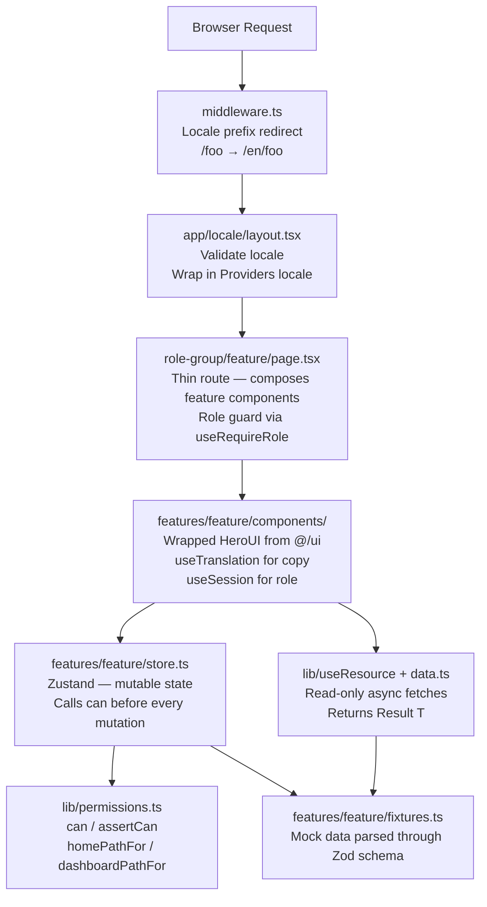
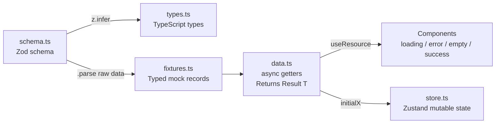

# Jalat — Frontend System Design

> **Phase:** Static UI first. No backend, real auth, WebSocket, or Knock yet.  
> Everything runs on mock fixtures behind each feature's `data.ts` and in-memory Zustand stores.  
> Auth.js, WebSocket, Knock, Sileo, MapLibre, and DayFlow are deferred — the structure is ready for real data to drop in.

---

## 1. What Jalat Is

Jalat is a travel/trip platform with three authenticated roles plus unauthenticated guests:

| Role | One-liner |
|------|-----------|
| **Admin** | Moderates the platform — confirms agency registrations, edits any activity, resolves reports, manages users. |
| **Tour Agency** | Upgraded traveler — creates activities and tour packages, manages bookings, files edit requests. |
| **Traveler** | Discovers content, books tours, creates trip plans, rates activities, reports agencies. |
| **Guest** | Unauthenticated visitor — browse and search only, no writes. |

---

## 2. Tech Stack

| Category | Library | Version | Purpose |
|----------|---------|---------|---------|
| Framework | Next.js | 16 (App Router) | SSR/SSG, file-based routing under `[locale]` |
| Language | TypeScript | 5 | Strict typing throughout |
| Runtime | React | 19 | UI rendering |
| Styling | Tailwind CSS | v4 | Utility-first; design tokens via `@theme` in `globals.css` |
| UI Components | HeroUI | v3 | Primary component library — always used via `@/ui` wrapper |
| UI (sidebar only) | shadcn/ui | latest | Sidebar primitives only; do not extend to other features |
| Client State | Zustand | v5 | One store per feature domain |
| Forms | React Hook Form | v7 | Wired to Zod schemas via `@hookform/resolvers` |
| Validation | Zod | v4 | Single source of truth for data shapes and form validation |
| i18n | i18next + react-i18next | v26 / v17 | Three locales: KH / KR / ENG |
| Animation | Framer Motion | v12 | Scroll-triggered reveals, transitions |
| Icons | iconsax-reactjs | 0.0.8 | Icon set; also lucide-react for sidebar |
| Page load bar | nextjs-toploader | v3 | Progress bar on navigation |
| Testing | Vitest + React Testing Library | v4 / v16 | Unit + component tests (jsdom) |

**Deferred (structure is ready):** Auth.js (real auth), WebSocket (booking updates), Knock (notifications), Sileo (toasts), MapLibre (3D map), DayFlow (calendar).

---

## 3. Folder Structure

```
src/
├── app/                            # Next.js App Router — thin route files only
│   ├── layout.tsx                  # Root: html/body/fonts/toploader (no providers)
│   ├── providers.tsx               # Client providers: i18n (future: Auth.js, Knock)
│   ├── globals.css                 # Tailwind v4 base + HeroUI tokens + design system
│   ├── favicon.ico
│   └── [locale]/                   # ALL routes under a locale segment (en / kh / kr)
│       ├── layout.tsx              # Validates locale, wraps children in Providers(locale)
│       ├── page.tsx                # Landing page — home for all roles + guests
│       ├── (auth)/                 # Route group: auth pages share AuthShell layout
│       │   ├── layout.tsx
│       │   ├── login/page.tsx
│       │   ├── register/page.tsx
│       │   ├── verify-otp/page.tsx
│       │   ├── forgot-password/page.tsx
│       │   └── reset-password/page.tsx
│       ├── destinations/
│       │   └── [slug]/page.tsx     # Dynamic destination detail
│       ├── (agency)/               # Route group: agency workspace
│       │   └── agency/
│       │       ├── layout.tsx      # Role guard: redirect non-agency users
│       │       ├── page.tsx
│       │       └── dashboard/page.tsx
│       ├── (traveler)/             # Route group: traveler workspace (stub)
│       │   └── traveler/
│       │       ├── layout.tsx
│       │       └── page.tsx
│       └── (admin)/                # Route group: admin control panel
│           └── admin/
│               ├── layout.tsx      # Role guard: redirect non-admin users
│               └── page.tsx
│
├── features/                       # Feature-first domain modules
│   ├── auth/                       # Authentication & session
│   │   ├── schema.ts               # Zod: Role, User, SessionUser, Login, Register, Otp, ForgotPassword, ResetPassword
│   │   ├── data.ts                 # login(), register(), verifyOtp(), resetPassword()
│   │   ├── fixtures.ts             # MOCK_USERS
│   │   ├── store.ts                # Zustand auth store (session state)
│   │   └── components/             # LoginForm, RegisterForm, VerifyOtpForm, ForgotPasswordForm, ResetPasswordForm, AuthShell, Field
│   │
│   ├── landing/                    # Public landing page
│   │   ├── components/             # Hero, MarketingHeader, SearchBar, DiscoverWorld, DestinationSection,
│   │   │                           #   FeaturedTours, RecommendedForYou, JourneySimple, AboutStats,
│   │   │                           #   Testimonials, WhyJalat, UnleashBanner, LandingCTA, Footer,
│   │   │                           #   SectionHeading, SocialIcons, LandingScreen
│   │   └── images.ts               # Image asset URLs
│   │
│   ├── destinations/               # Browse + detail views
│   │   ├── schema.ts               # Zod: DestinationCategory, Destination, FeaturedTour
│   │   ├── data.ts                 # getFeaturedDestinations(), getTrendingDestinations(), getDestinationBySlug(), getFeaturedTours()
│   │   ├── fixtures.ts             # DESTINATIONS, FEATURED_TOURS (Unsplash seeded)
│   │   ├── types.ts                # z.infer exports
│   │   ├── hooks.ts                # Feature hooks
│   │   └── components/             # DestinationCard, TourCard, DestinationDetailScreen
│   │
│   ├── agency/                     # Tour agency workspace
│   │   ├── schema.ts               # Zod: ActivityStatus, Activity, NewActivity, Package, BookingRequest, BookingStatus
│   │   ├── data.ts                 # getPackages(), getActivities(), initialBookings(), initialActivities()
│   │   ├── fixtures.ts             # AGENCY_ACTIVITIES, AGENCY_PACKAGES, AGENCY_BOOKINGS
│   │   ├── store.ts                # Zustand: addActivity(), approveBooking(), rejectBooking(), requestEdit() — each calls can()
│   │   ├── store.test.ts           # Vitest: permission-gated transition tests
│   │   └── components/             # AgencyWorkspace, BookingRequestsPanel, ActivitiesPanel, PackagesPanel
│   │
│   ├── admin/                      # Admin control panel
│   │   ├── schema.ts               # Zod: AgencyRequestStatus, AgencyRequest, ReportStatus, Report, PlatformActivity, UserSummary
│   │   ├── data.ts                 # getPlatformActivities(), getUsers(), initialAgencyRequests(), initialReports()
│   │   ├── fixtures.ts             # ADMIN_ACTIVITIES, ADMIN_AGENCY_REQUESTS, ADMIN_REPORTS, ADMIN_USERS
│   │   ├── store.ts                # Zustand: approveAgencyRequest(), rejectAgencyRequest(), resolveReport(), dismissReport()
│   │   ├── store.test.ts           # Vitest: admin store permission tests
│   │   └── components/             # AdminControlPanel, AgencyRequestsQueue, ReportsQueue, UsersPanel, ActivitiesAdmin
│   │
│   └── dashboard/                  # Shared dashboard utilities
│       ├── components/             # DashboardScreen
│       ├── nav.ts                  # Navigation config per role
│       └── config.ts               # Dashboard tabs/routes config
│
├── ui/                             # HeroUI extended-variant wrapper layer (the ONLY place features import UI from)
│   ├── Button.tsx                  # Jalat-themed button (not polymorphic — no as/href)
│   ├── Input.tsx                   # Text input with Jalat tokens
│   ├── PasswordInput.tsx           # Input + visibility toggle
│   ├── TextArea.tsx                # Multi-line input
│   ├── Select.tsx                  # Dropdown select / ListBox
│   ├── Card.tsx                    # Content card
│   ├── Chip.tsx                    # Tag/badge
│   ├── StatusChip.tsx              # Domain status → color + localized label
│   ├── Skeleton.tsx                # Loading skeleton
│   ├── Reveal.tsx                  # Framer Motion scroll-triggered reveal
│   └── index.ts                    # Single export point for all UI imports
│
├── lib/                            # Shared utilities (server-safe unless noted)
│   ├── permissions.ts              # CENTRAL auth module: can(), assertCan(), homePathFor(), dashboardPathFor()
│   ├── permissions.test.ts         # Full permission matrix test coverage
│   ├── auth.ts                     # Session shape + useSession() + useRequireRole() [client]
│   ├── locales.ts                  # Pure locale constants: LOCALES, DEFAULT_LOCALE, isValidLocale() [server-safe]
│   ├── locale.ts                   # Locale routing: LocaleLink component, useLocalizedRouter() hook [client]
│   ├── i18n.ts                     # i18next init (side effect — do NOT import from Server Components)
│   ├── useResource.ts              # Universal data-loading hook: useResource(getter) → { status, data, reload }
│   ├── format.ts                   # Locale-aware Intl formatting: formatPrice(), formatNumber(), formatRating()
│   └── utils.ts                    # cn() (clsx + tailwind-merge), other generic helpers
│
├── components/                     # Shared global components (not feature-scoped)
│   ├── LanguageSwitcher.tsx        # Language dropdown on every page (landing, auth, app shell)
│   ├── LocaleLink.tsx              # Locale-preserving link wrapper (always use instead of next/link)
│   ├── layout/
│   │   ├── AppShell.tsx            # Top-level shell for authenticated routes (header + sidebar + content)
│   │   └── DashboardSidebar.tsx    # Role-specific sidebar nav
│   ├── sidebar/                    # shadcn/ui sidebar — sidebar only, do not use elsewhere
│   │   ├── sidebar.tsx
│   │   ├── sheet.tsx
│   │   └── use-mobile.ts
│   └── ui/                         # shadcn/ui primitives for sidebar only
│       ├── avatar.tsx
│       └── button.tsx
│
├── locales/                        # Centralized i18n translation files
│   ├── en.json                     # English (~2,500 keys, ~900 entries)
│   ├── kh.json                     # Khmer (longer strings, no inter-word spaces)
│   └── kr.json                     # Korean (different number/date conventions)
│
├── test/
│   └── setup.ts                    # Vitest global setup (mocks, jest-dom matchers)
│
└── middleware.ts                   # Locale routing: redirects /foo → /en/foo
```

---

## 4. Architecture Layers



### Key constraints enforced at each layer

| Layer | Constraint |
|-------|-----------|
| `middleware.ts` | Only locale redirect — no auth logic |
| `app/[locale]/layout.tsx` | Only locale validation + `Providers` — no data fetching |
| Route `page.tsx` | Thin — compose feature components, no business logic |
| Feature components | Import from `@/ui` only (never `@heroui/react`). All copy via `t()`. Role via `useSession()`. |
| Zustand stores | Call `can(actor, action)` before every mutation |
| `data.ts` | Components never import from `fixtures.ts` directly — only via `data.ts` |

---

## 5. Permission System

**File:** `src/lib/permissions.ts` — the **only** place role logic lives.

### Actor & Action types

```ts
type Role = "admin" | "agency" | "traveler";
type Actor = Role | "guest";   // null is treated as guest

type Action =
  // Shared
  | "browse"
  // Traveler
  | "book" | "bookmark" | "createTripPlan" | "rateActivity"
  | "reportAgency" | "requestAgencyUpgrade"
  // Agency
  | "viewWorkspace" | "manageOwnActivities" | "requestActivityEdit"
  | "managePackages" | "approveBookings"
  // Admin
  | "moderate" | "manageAgencyRequests" | "manageReports"
  | "manageUsers" | "editAnyActivity";
```

### Permission Matrix

| Action | Admin | Agency | Traveler | Guest |
|--------|:-----:|:------:|:--------:|:-----:|
| browse | ✓ | ✓ | ✓ | ✓ |
| book | | | ✓ | |
| bookmark | | | ✓ | |
| createTripPlan | | | ✓ | |
| rateActivity | | | ✓ | |
| reportAgency | | | ✓ | |
| requestAgencyUpgrade | | | ✓ | |
| viewWorkspace | | ✓ | | |
| manageOwnActivities | | ✓ | | |
| requestActivityEdit | | ✓ | | |
| managePackages | | ✓ | | |
| approveBookings | ✓ | ✓ | | |
| moderate | ✓ | | | |
| manageAgencyRequests | ✓ | | | |
| manageReports | ✓ | | | |
| manageUsers | ✓ | | | |
| editAnyActivity | ✓ | | | |

### API surface

```ts
// Returns true/false — use for UI gates (show/hide buttons)
can(actor: Actor | null, action: Action): boolean

// Throws PermissionError — use in store mutations (defense in depth)
assertCan(actor: Actor | null, action: Action): void

// Post-login redirect
homePathFor(role: Role): string       // admin→"/admin", others→"/"
dashboardPathFor(role: Role): string  // admin→"/admin", agency→"/agency", traveler→"/traveler"
```

### Rules
- **Never inline role checks** (`if (role === "admin")`) — always call `can()`.
- **Defense in depth:** UI gates (hide button) are UX; store mutation `assertCan()` is security. Both are required.
- `null` actor is always treated as `"guest"` — read-only `browse` only.

---

## 6. Authentication & Session

**Current:** mock session backed by `features/auth/store.ts` and `lib/auth.ts`.  
**Future:** drop in Auth.js (NextAuth) with the same `{ user, role }` session shape — no component changes needed.

### Session shape

```ts
// features/auth/schema.ts
const SessionUserSchema = UserSchema.omit({ password: true });
// → { id: string, name: string, email: string, role: Role }

// lib/auth.ts
function useSession(): {
  user: SessionUser | null;
  role: Role | null;
  isAuthenticated: boolean;
  hasHydrated: boolean;   // prevents flash of wrong state on first render
}
```

### Client hooks

```ts
// Read current session in any client component
const { user, role, isAuthenticated } = useSession();

// Route guard — redirects if wrong role; holds render until hydrated
useRequireRole("agency");
```

### Demo accounts (mock auth)

| Email | Password | Role |
|-------|----------|------|
| `admin@jalat.test` | `Admin@123` | Admin |
| `agency@jalat.test` | `Agency@123` | Tour Agency |
| `traveler@jalat.test` | `Traveler@123` | Traveler |

OTP demo code: `123456`

---

## 7. Data Architecture

### 7a. Schema → Type → Fixture → Data pipeline



### 7b. Fixture pattern

Fixtures validate against schemas at import time so mock data can never drift:

```ts
// features/destinations/fixtures.ts
const RAW_DESTINATIONS = [ /* plain objects */ ];
export const DESTINATIONS: Destination[] = RAW_DESTINATIONS.map(d =>
  DestinationSchema.parse(d)   // throws at startup if fixture is wrong
);
```

### 7c. Data module pattern

`data.ts` is the ONE seam between components and data. Swapping fixtures for real API calls is a single-file change:

```ts
// Two result patterns used across the codebase:

// Pattern A — generic discriminated result
type Result<T> = { ok: true; data: T } | { ok: false; error: "load_failed" | "not_found" };

export async function getFeaturedDestinations(): Promise<Result<Destination[]>> {
  await delay(350);  // simulate network in static phase
  return { ok: true, data: DESTINATIONS.filter(d => d.featured) };
}

// Pattern B — operation-specific errors
type LoginResult = { ok: true; user: SessionUser } | { ok: false; error: "invalid_credentials" };

// Store initializers seed Zustand from fixtures
export function initialBookings(): BookingRequest[] { return AGENCY_BOOKINGS; }
```

Never throw strings — always return a discriminated result.

### 7d. `useResource` hook

`src/lib/useResource.ts` — universal loader for any `data.ts` getter:

```ts
function useResource<T>(fetcher: () => Promise<Loadable<T>>): {
  status: "loading" | "success" | "error";
  data: T | null;
  reload: () => void;
}
```

Every data-driven component **must** render all four states:

```tsx
const { status, data, reload } = useResource(getFeaturedDestinations);

if (status === "loading") return <CardSkeleton repeat={3} />;
if (status === "error")   return <ErrorState onRetry={reload} />;
if (!data?.length)        return <EmptyState />;
return <DestinationGrid items={data} />;
```

---

## 8. State Management

### Zustand store pattern

One store per feature domain. Store mutations always permission-check before mutating:

```ts
// features/agency/store.ts
export const useAgencyStore = create<AgencyState>((set) => ({
  bookings: initialBookings(),
  activities: initialActivities(),

  approveBooking: (actor, id) => {
    if (!can(actor, "approveBookings")) return false;  // ← defense in depth
    set(s => ({ bookings: setStatus(s.bookings, id, "approved") }));
    return true;
  },
}));
```

### Rules

- Seed stores from `data.ts` initializers (`initialX()`), never from `fixtures.ts` directly.
- Components select **narrowly**: `useAgencyStore(s => s.bookings)` — not the full store.
- Read-only fetches use `useResource(getter)` and are NOT stored in Zustand.
- Mutable domain state (booking approve/reject, agency onboarding) belongs in a store.

### Existing stores

| Store | Feature | Transitions |
|-------|---------|-------------|
| `useAuthStore` | auth | login, logout, register |
| `useAgencyStore` | agency | addActivity, requestEdit, approveBooking, rejectBooking |
| `useAdminStore` | admin | approveAgencyRequest, rejectAgencyRequest, resolveReport, dismissReport |

---

## 9. UI Component Architecture

### 9a. HeroUI wrapper layer (`src/ui/`)

**Rule:** Feature code never imports from `@heroui/react` directly — only from `@/ui`.

The wrapper layer bakes in Jalat's design tokens, sizes, and default variants:

```ts
// Feature code
import { Button, Card, StatusChip, Reveal } from "@/ui";

// src/ui/Button.tsx — Jalat-themed wrapper
export function Button({ variant, size, className, ...props }: UIButtonProps) {
  return <HeroButton className={jalatButton({ variant, size, className })} {...props} />;
}
// HeroUI v3 Button is NOT polymorphic — no as/href prop.
// Navigate with: onPress={() => router.push(path)}
```

**Wrapped components (Jalat styling baked in):**
Button, Input, PasswordInput, TextArea, Select, Card, Chip, StatusChip, Skeleton, Reveal

**Pass-throughs (re-exported as-is):**
Form, Label, Avatar, Spinner, Separator, Link, Dropdown, Tabs, Modal, AlertDialog, Checkbox, RadioGroup, Radio

### 9b. StatusChip

Maps domain status values to HeroUI chip colors + localized labels:

```ts
// Status values: draft | published | pending | approved | rejected | completed | open | resolved | dismissed
<StatusChip status={booking.status} />
// → renders <Chip color="warning">Pending</Chip>  (color + label both from the status string)
```

### 9c. Reveal

Scroll-triggered Framer Motion reveal — used for landing page card grids:

```tsx
{destinations.map((d, i) => (
  <Reveal key={d.id} delay={i * 0.06}>
    <DestinationCard destination={d} />
  </Reveal>
))}
```

Respects `prefers-reduced-motion`.

### 9d. shadcn/ui scope

`src/components/sidebar/` and `src/components/ui/` — **sidebar only**. Do not pull in additional shadcn components.

---

## 10. Routing Architecture

### Locale prefix

Every route lives under `[locale]` (`/en/…`, `/kh/…`, `/kr/…`):

```
/en/login         /kh/login         /kr/login
/en/agency        /kh/agency        /kr/agency
/en/admin         /kh/admin         /kr/admin
/en/destinations/angkor-wat
```

`middleware.ts` redirects unprefixed paths (`/login` → `/en/login`) using the `NEXT_LOCALE` cookie or defaulting to `en`.

### Navigation rule

**Always use `LocaleLink` or `useLocalizedRouter`** — never raw `next/link` or `useRouter` for in-app nav:

```tsx
// ✓ Correct — preserves locale
import { LocaleLink } from "@/components/LocaleLink";
<LocaleLink href="/agency">Agency workspace</LocaleLink>

// ✓ Also correct — programmatic navigation
const router = useLocalizedRouter();
router.push("/admin");

// ✗ Wrong — loses locale prefix
import Link from "next/link";
<Link href="/agency">...</Link>
```

### Role-based home and dashboard

```ts
homePathFor("admin")     // → "/admin"   (post-login redirect for admins)
homePathFor("traveler")  // → "/"        (landing page)
homePathFor("agency")    // → "/"        (landing page)

dashboardPathFor("admin")     // → "/admin"
dashboardPathFor("agency")    // → "/agency"
dashboardPathFor("traveler")  // → "/traveler"
```

### Route groups

| Group | Path | Layout |
|-------|------|--------|
| `(auth)` | `/[locale]/login`, `/register`, etc. | `AuthShell` |
| `(agency)` | `/[locale]/agency/**` | Role guard + `AppShell` (agency sidebar) |
| `(traveler)` | `/[locale]/traveler/**` | Role guard + `AppShell` |
| `(admin)` | `/[locale]/admin/**` | Role guard + `AppShell` (admin sidebar) |

---

## 11. i18n Architecture

### Three locales

| Code | Language | Notes |
|------|----------|-------|
| `en` | English | Source/fallback locale |
| `kh` | Khmer | No inter-word spaces; Khmer numerals; longer strings |
| `kr` | Korean | Different date/number conventions; longer strings |

### Namespace structure

Keys are namespaced by feature in `src/locales/{en,kh,kr}.json`:

| Namespace | Coverage |
|-----------|----------|
| `common.*` | appName, loading, logout, language, retry, viewAll, cancel, confirm, save |
| `status.*` | draft, published, pending, approved, rejected, completed, open, resolved, dismissed |
| `roles.*` | admin, agency, traveler |
| `nav.*` | destinations, tours, dashboard, workspace, controlPanel, menu |
| `auth.*` | login, register, otp, forgot-password, reset-password flows |
| `landing.*` | hero, featured, trending, tours, why, cta, footer, testimonials, discover |
| `destinations.*` | card, categories, states (empty/error/notFound), detail view |
| `agency.*` | workspace tabs, activities form, packages, bookings |
| `admin.*` | control panel tabs, agency requests, reports, users, activities |
| `dashboard.*` | role-specific greeting + dashboard copy |

### Usage patterns

```tsx
const { t, i18n } = useTranslation();
const lng = i18n.language;

// Basic key
t("common.loading")

// Interpolation
t("agency.bookings.greeting", { name: user.name })  // "Hello, {{name}}"

// Plural
t("agency.packages.days", { count: pkg.days })      // "1 day" / "3 days"

// Locale-aware formatting (never use raw Intl directly)
import { formatPrice } from "@/lib/format";
formatPrice(pkg.priceFrom, pkg.currency, lng)       // "$38" / "38 USD" / "38 달러"
```

### Rules

- **No hardcoded user-facing strings** — every string goes through `t()`.
- **Every key must exist in all three locales** — a key in `en` but missing in `kh`/`kr` is a bug.
- `lib/i18n.ts` has initialization side effects — **do not import from Server Components**.
- `lib/locales.ts` is pure (no side effects) — safe to import from Server Components and middleware.

---

## 12. Cross-Cutting Domain Flows

These four flows span multiple features and are where permissions, state, and (future) notifications intersect.

### Flow 1 — Agency Onboarding

```
Traveler registers with accountType="agency"
  → Admin sees request in AgencyRequestsQueue (admin/store.ts)
  → Admin calls approveAgencyRequest(actor, id) — can(actor, "manageAgencyRequests")
  → Role flips: traveler → agency in session
  → Agency workspace unlocks (viewWorkspace, manageOwnActivities, managePackages, approveBookings)
```

**Permissions involved:** `requestAgencyUpgrade` (traveler), `manageAgencyRequests` (admin)  
**State:** `useAdminStore` (request list), `useAuthStore` (role in session)

### Flow 2 — Booking Lifecycle

```
Traveler requests a tour — can(actor, "book")
  → BookingRequest created with status="pending" in agency store
  → Agency calls approveBooking(actor, id) — can(actor, "approveBookings")
  → Status transitions: pending → approved → completed
  → Traveler can now rate — can(actor, "rateActivity") (only on completed trips)
```

**Permissions involved:** `book` (traveler), `approveBookings` (agency/admin), `rateActivity` (traveler, post-completion)  
**State:** `useAgencyStore` (booking list and transitions)

### Flow 3 — Activity Edit Requests

```
Agency creates activity (status="draft")
  → Agency publishes — can(actor, "manageOwnActivities")
  → Agency cannot edit published activity directly (in most cases)
  → Agency files edit request — can(actor, "requestActivityEdit")
  → Admin sees request, approves edit — can(actor, "manageAgencyRequests")
  → OR Admin edits directly — can(actor, "editAnyActivity")
```

**State:** `useAgencyStore` (activities + edit requests), `useAdminStore` (edit request queue)

### Flow 4 — Trip Plans

```
Traveler creates a trip plan — can(actor, "createTripPlan")
  → Plan is private by default
  → Traveler publishes → plan is public (shareable link)
  → Other travelers/guests can browse public plans — can(actor, "browse")
```

**State:** `features/trip-plans/store.ts` (planned, not yet built)

---

## 13. Testing Strategy

### What's tested today

| File | What it tests |
|------|--------------|
| `src/lib/permissions.test.ts` | Full permission matrix — every role × action combination |
| `src/features/auth/schema.test.ts` | Zod auth schemas (login, register, OTP validation rules) |
| `src/features/destinations/schema.test.ts` | Destination/tour Zod schema validation |
| `src/features/agency/store.test.ts` | Agency store transitions with permission gate re-check |
| `src/features/admin/store.test.ts` | Admin store transitions with permission gate re-check |

### Test patterns

```ts
// Pattern: test the state machine, not the rendering
describe("agency store — booking transitions", () => {
  it("agency can approve a pending booking", () => {
    const ok = useAgencyStore.getState().approveBooking("agency", id);
    expect(ok).toBe(true);
    expect(store.getState().bookings.find(b => b.id === id)?.status).toBe("approved");
  });

  it("traveler cannot approve (permission re-check at mutation layer)", () => {
    const ok = useAgencyStore.getState().approveBooking("traveler", id);
    expect(ok).toBe(false);
    // status unchanged
  });
});
```

### Running tests

```bash
npm test                                        # run all tests once
npm run test:watch                              # watch mode
npx vitest run src/lib/permissions.test.ts      # single file
npx vitest run -t "approve"                     # filter by name
```

### Future coverage (not yet built)

- **Playwright** — cross-cutting flows end-to-end (agency onboarding, booking lifecycle)
- **Component tests** — loading/error/empty state rendering for data-driven components
- **i18n coverage** — assert all three locales have the same key set

---

## 14. Adding a New Feature — Checklist

Follow this order to stay consistent with the existing architecture:

1. **Schema first** — define `src/features/<feature>/schema.ts` with Zod; derive types via `z.infer`.
2. **Fixtures** — add `fixtures.ts` with mock data that passes `Schema.parse()`.
3. **Data module** — add `data.ts` with async getters returning `Result<T>` and store initializers.
4. **Store** — add `store.ts` if there's mutable state; call `can()` before every mutation.
5. **Permissions** — if new actions are needed, add them to the `MATRIX` in `lib/permissions.ts` first.
6. **Components** — build UI in `components/` using `@/ui` wrappers; use `useResource` for data; handle loading/error/empty/success.
7. **Routes** — add thin `page.tsx` under the right route group; add role guard in the group `layout.tsx`.
8. **i18n** — add keys to `src/locales/en.json`, `kh.json`, `kr.json` simultaneously.
9. **Tests** — at minimum, test the permission matrix entries and any store transitions.
